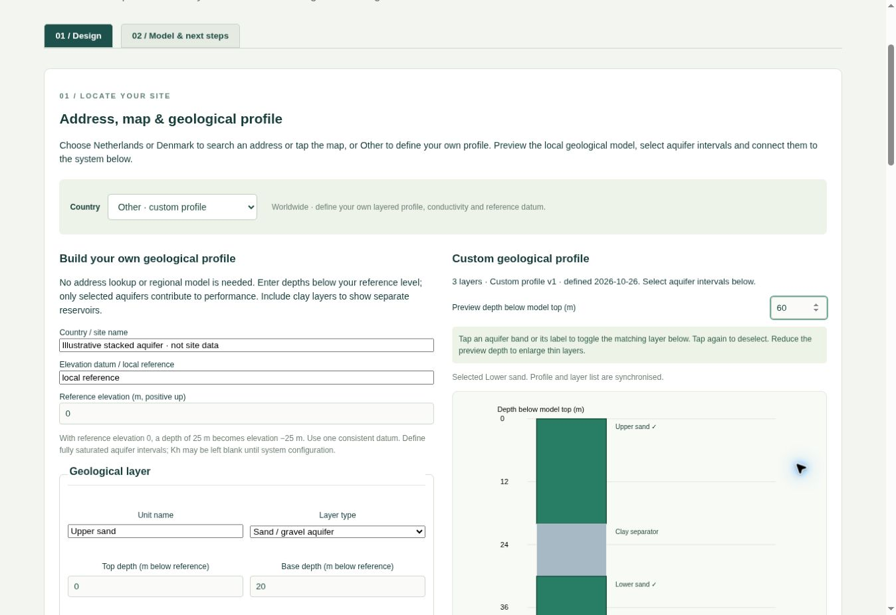
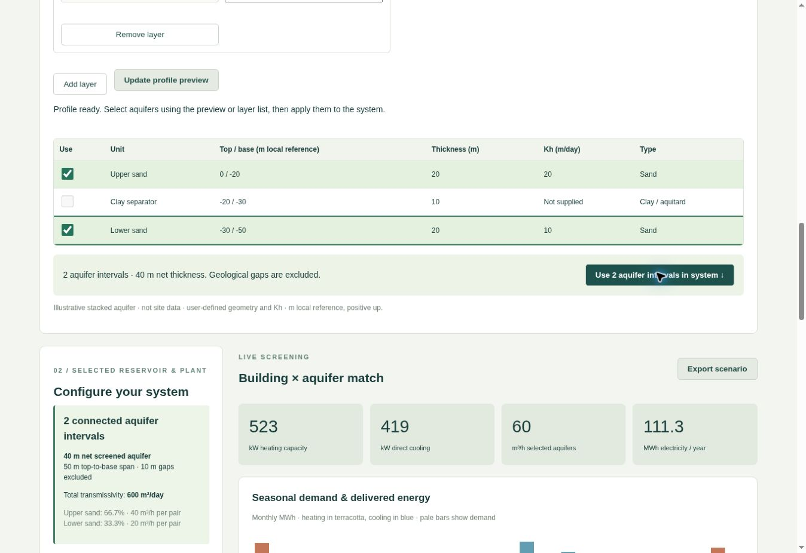
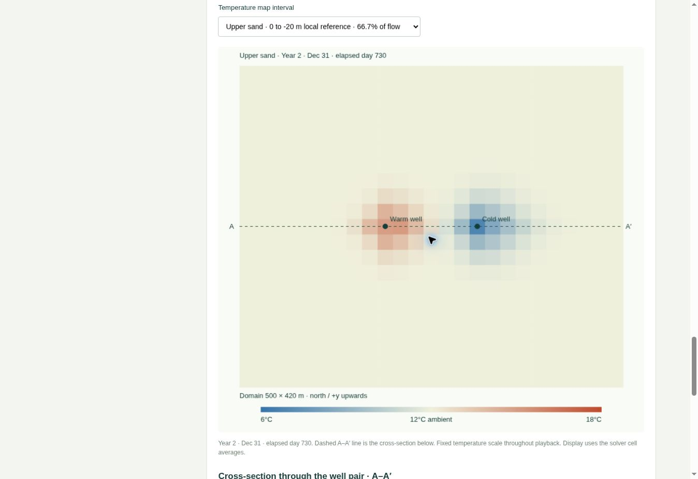
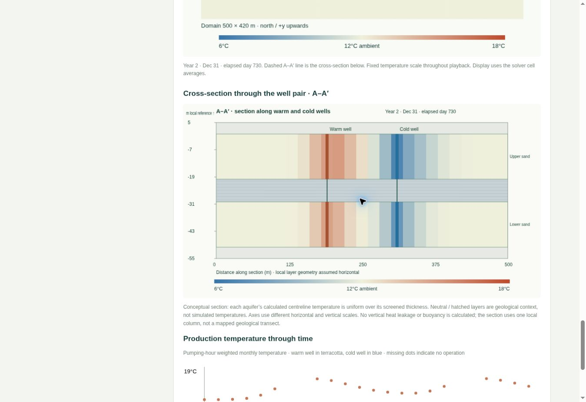

# User guide

ATES Explorer screens low-temperature open-loop aquifer thermal energy storage against monthly building heating/cooling demand. Calculations are experimental and are performed in the browser.

## 1. Define the geology

**Netherlands:** search an address/place, select a map point or enter Dutch RD coordinates (EPSG:28992). The profile comes from TNO REGIS II. **Denmark:** use a house-number address, map point or UTM 32N coordinates (EPSG:25832). Choose one named FOHM/DK-model group; overlapping source models are never merged. Danish Kh must be entered manually.

**Other / custom profile:** national lookup controls disappear. Enter a site label, name the vertical datum/local reference, and enter its reference elevation. Add named layers with type, top/base depths, optional Kh and evidence. Depths are positive down from that reference. With reference elevation 40 m and depths 10–25 m, the layer elevations are +30 to +15 m. Blank geometry, overlapping layers, duplicate unit names and invalid conductivity are rejected. Update the profile preview after editing.

Tap an aquifer band/label or check its row to select it. Tap again to deselect. Keyboard Enter/Space also works on profile bands. Select multiple aquifers separated by clay if needed, then **Use selected aquifer intervals**. Clay contributes neither screened thickness nor transmissivity. At most 12 aquifer intervals can be connected. Aquifer intervals must represent fully saturated screens; no water-table correction is made automatically.

## 2. Configure screens, plant and building

Edit each screen's top/base and Kh. A screen must remain inside its selected geological unit. Missing Kh blocks calculation; evidence fields record tests or assumptions. Net screened thickness and thickness-weighted Kh are calculated automatically. Flow splits by transmissivity under a shared-head assumption.

Set requested flow, well spacing, independent pair count, allowable head change, pumping head/efficiency, nominal COP and building loads. Import monthly demand with header `month,heat_MWh,cool_MWh`, exactly 12 rows in month order, nonnegative values. Imported data overrides generated annual profiles. Download [example-loads.csv](../src/data/example-loads.csv) for the format.

The results report delivered and unmet energy, capacity and electricity. Backup supply is excluded. Monthly matching does not establish hourly peak coverage.

## 3. Interpret thermal balance

The screening balance compares aquifer-side heat injected and extracted. Positive injection minus extraction implies net heat addition; negative implies net removal. Building heat includes compressor electricity, so equal building heating/cooling demand is not necessarily balanced aquifer energy. At nominal COP 5, delivering 100 MWh of heating removes approximately 80 MWh from the aquifer.

The transient result's energy-balance residual is a numerical conservation check, not an operational balance target. Also compare production temperatures and plume geometry at the same season in successive years. Background flow can remove stored energy even when annual well-side energy is balanced. Year-by-year balance charts and a flow-direction arrow remain future work.

## 4. Run and inspect thermal transport

Set ambient and injection temperatures, heating/cooling supply temperatures, bulk saturated heat capacity, thermal conductivity, dispersivity, regional head gradient/direction, cell size, domain margin and duration. The gradient arrows step by 0.001 m/m. Gradient zero disables background flow. The angle is relative to model +x (warm-to-cold well axis), not a georeferenced compass bearing. Do not interpret the map's generic north/+y text as a surveyed well orientation.

Choose daily, weekly or month-end saved states and run. Use the time slider, stepping or playback; select an aquifer for the plan view. The cross-section shows all connected screens at the same time. It extrudes depth-averaged fields through their screens and repeats the local geology horizontally; it is not a vertically resolved simulation. Check reported snapped well spacing, grid convergence and domain size.

## 5. Save and restore

Export scenario JSON to preserve inputs, profile provenance, selected screens, custom definitions and evidence. Restore with the JSON file control, then rerun thermal simulation. Exports do not automatically repopulate a previous thermal calculation as an active result. Monthly screening CSV and thermal JSON exports support further analysis. Files are explicit downloads, with no automatic project storage.

Changing location, model group, country, draft aquifer selection or custom profile invalidates previous calculations. After a custom edit, update the preview and reconnect the chosen aquifers.

## More countries

The Model & next steps tab links the [European inventory](../src/pages/europe-models.html) and [EGT integration request](../src/pages/estonia-integration.html). These are research/integration documents, not active country adapters. Estonia can currently be evaluated through Other with user-defined data.
